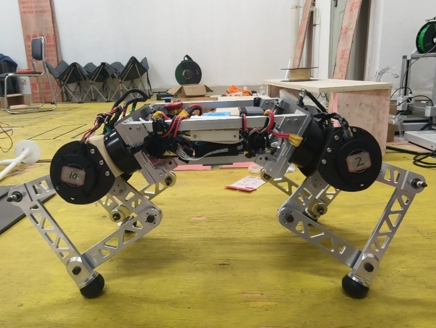
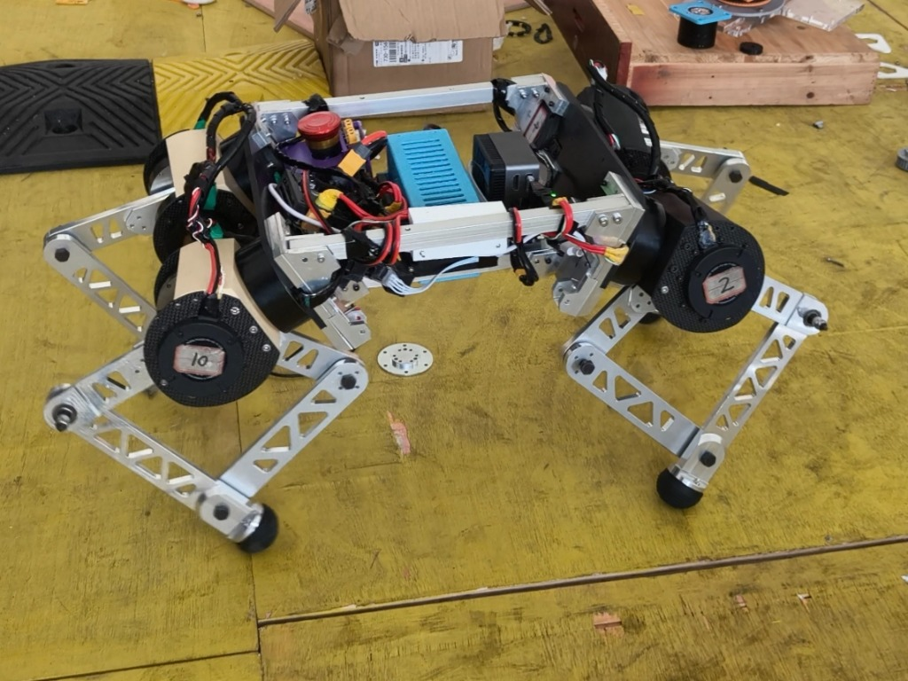
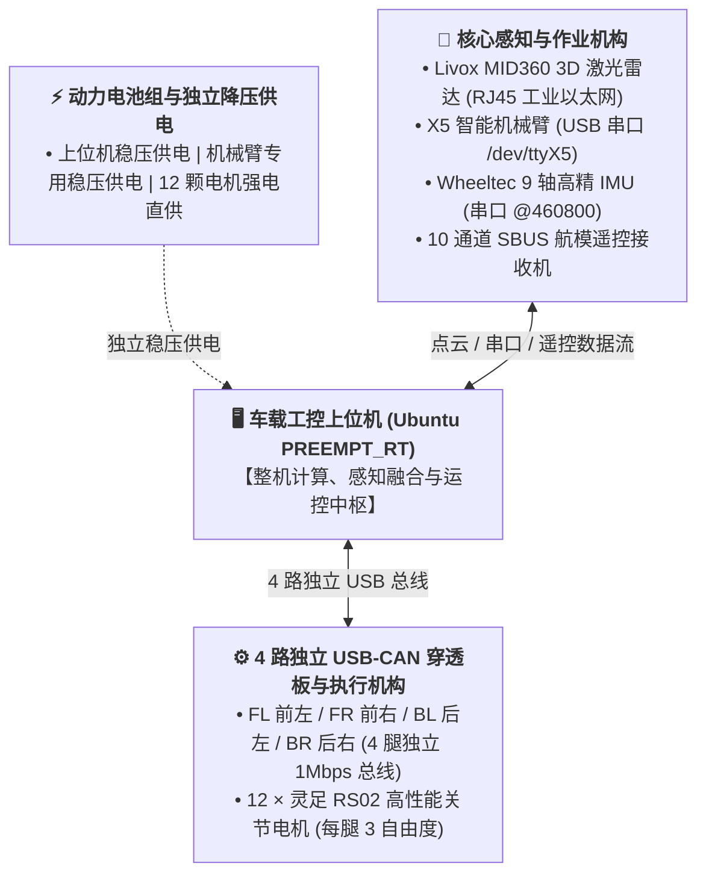
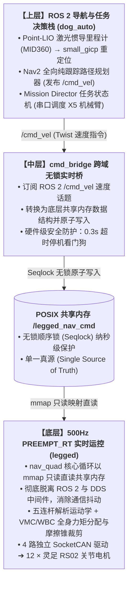

# ROBOCON 2026 足式机器人（一队）

<p align="center">
  
  
  
  
  
  
</p>

---

## 1. 系统概述

全国大学生机器人大赛 ROBOCON 2026 赛季足式机器人（一队）整机开源工程，分为两大独立解耦子系统：
- **`legged/`（障碍赛运控）**：12 自由度放大式五连杆（5-bar pantograph）并联腿机构，搭载 12 颗**灵足 RS02** 关节电机与 4 路独立 SocketCAN。基于 PREEMPT_RT 实时内核实现 **500Hz VMC + WBC 全身动力学力控**，内置台阶青蛙跳、碎石路脱困与木桥长跳等竞技步态；
- **`dog_auto/`（任务赛全自主）**：以 Livox MID360 3D 激光雷达为核心，结合 Point-LIO 激光惯导里程计、small_gicp 点云重定位与 Nav2 全向跟踪；通过 FSM 决策教练机与 X5 智能机械臂协同，实现视觉识别、物料扫描与自动抓取码垛。

---

## 2. 实机展示

<div align="center">
  <table>
    <tr>
      <td align="center"><b>机器狗正侧视图 (Side View)</b></td>
      <td align="center"><b>机器狗等轴侧视图 (Isometric View)</b></td>
    </tr>
    <tr>
      <td></td>
      <td></td>
    </tr>
    <tr>
      <td align="center">高刚度 CNC 铝合金镂空连杆 · 紧凑中置电机布局</td>
      <td align="center">分层强弱电物理隔离 · 4 路 CAN 穿透板与双托盘架构</td>
    </tr>
  </table>
</div>

---

## 3. 硬件规格与电气拓扑

### 3.1 核心硬件参数
| 模块 | 选型方案 | 接口 / 通信协议 | 运行特性 |
| :--- | :--- | :--- | :--- |
| **机构构型** | 12-DOF 对称五连杆并联腿 (5-bar pantograph) | - | 每腿 3 自由度（Roll偏置 + 并联双 Pitch） |
| **驱动电机** | 12 × **灵足 RS02** 高性能关节电机 | 4 路独立 USB-CAN (1Mbps) | 私有 CAN 协议，大减速比与高动态力矩 |
| **车载上位机** | 车载工控核心 (x86_64) | Ubuntu 22.04 LTS | PREEMPT_RT 实时补丁，统一调度导航与运控 |
| **激光感知** | **Livox MID360** 3D 激光雷达 | RJ45 工业以太网 | 360° × 59° 超大视场角高频点云流 |
| **作业机构** | **X5 智能机械臂单元** | USB 串口 `/dev/ttyX5` | 自定义紧凑二进制协议，集成视觉识别与抓取 |
| **姿态感知** | **Wheeltec 9 轴高精 IMU** | USB 串口 `/dev/wheeltec_IMU` | 460800 高波特率原始角速度/线加速度流 |
| **遥控通信** | **10 通道 SBUS 接收机** | 串口通信 | 支持底盘全向摇杆操控、高度调节与跳跃模式触发 |

### 3.2 硬件电气互联图


---

## 4. 控制架构与 DDS-Free 无锁实时桥

系统在上位机内部实施了**进程级 DDS 隔离架构**，彻底杜绝上层 ROS 2 通信抖动对 500Hz 底层力控闭环的影响：



---

## 5. 核心算法特性

### 5.1 VMC + WBC 全身动力学力控架构 (`legged/`)
- **笛卡尔顺应性与全身解耦**：系统融合 **VMC（Virtual Model Control 虚拟模型控制）** 与 **WBC（Whole-Body Control 全身动力学控制）** 核心思想。电机底层固件增益置零（$K_p = 0$），将接触顺应性与机身姿态跟踪完全交由笛卡尔阻抗与全身任务分层模型管理；
- **动力学任务映射公式**：
  $$\boldsymbol{\tau}_{motor} = \boldsymbol{J}^T \cdot \left( \boldsymbol{F}_{imp} + \boldsymbol{F}_{body} \right) + \boldsymbol{\tau}_{grav} + \boldsymbol{\tau}_{sag}$$
  - $\boldsymbol{F}_{imp}$：足端虚拟弹簧-阻尼阻抗力；
  - $\boldsymbol{F}_{body}$：机身 6D 空间广义力 $\boldsymbol{W}_{des}$ 经闭式几何力分配解算的反力分摊；
  - $\boldsymbol{\tau}_{grav} + \boldsymbol{\tau}_{sag}$：借鉴 WBC 任务优先级前馈思想，实现五连杆闭环连杆自重补偿与矢状面刚度下垂补偿；
- **地面摩擦锥裁剪约束**：支撑腿地面接触力受限于严格的摩擦锥不等式约束（$F_z > 0, \sqrt{F_x^2 + F_y^2} \le \mu F_z$），从根源杜绝支撑打滑；
- **特技跳跃步态**：
  - `jump_stair_up()`：后腿爆发弹射、前腿收拢前探的高动态非对称轨迹，配合自动瞬时解冻 Pitch 姿态环自适应贴合台阶；
  - `jump_gravel()`：增大足端离地间隙的高爆发弹跳，适应松软碎石地形；
  - `jump_bridge_b()`：高纵深前冲长跳，跃过断桥与壕沟。

### 5.2 激光惯导 SLAM 与任务决策 (`dog_auto/`)
- **Point-LIO + small_gicp**：紧耦合 MID360 内置 IMU，提供 200Hz 激光里程计与极速全局重定位；
- **同源栅格代价地图**：建图退出时截取高度带 `0.1m ~ 0.8m` 点云正交投影，自动生成与 PCD 天然对齐的 2D 代价栅格，无需人工对齐坐标系；
- **确定性 FSM 任务教练**：以状态机为核心统筹全场作业（S0 初始化 $\rightarrow$ S1 数字识别 $\rightarrow$ S2 原料扫描 $\rightarrow$ S3/S4 左右抓取 $\rightarrow$ S5 分区分拣码垛 $\rightarrow$ 自主返航）。

---

## 6. 代码组织结构

```bash
legged_control/
├── README.md               # 整机总架构文档 (本文件)
├── docs/images/            # 实机展示照片与架构拓扑图
├── legged/                 # 障碍赛 500Hz 纯 VMC + WBC 运控工程 (C++17)
│   ├── README.md           # [编译与快速运行指南](legged/README.md)
│   ├── scripts/            # CAN 总线脚本 (setup-can.sh, can-watchdog.sh)
│   └── src/parallel_vmc/   # RT 核心源码 (driver, kinematics, dynamics, planning, task)
└── dog_auto/               # 任务赛全自主系统 (ROS 2 Humble)
    ├── README.md           # [编译与快速发车指南](dog_auto/README.md)
    ├── nav/                # MID360 激光导航栈 (point_lio, small_gicp, nav2)
    ├── dicision/           # 任务决策机 (mission_director, X5 串口协议)
    └── legged_nav/         # 任务赛底盘实时桥 (cmd_bridge, nav_quad 共享内存通信)
```

---

## License

本项目遵循 [Apache-2.0 License](LICENSE) 开源协议。
